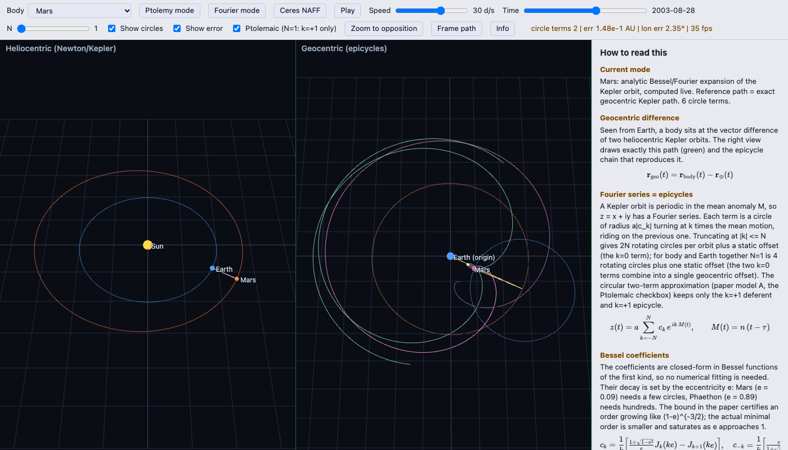
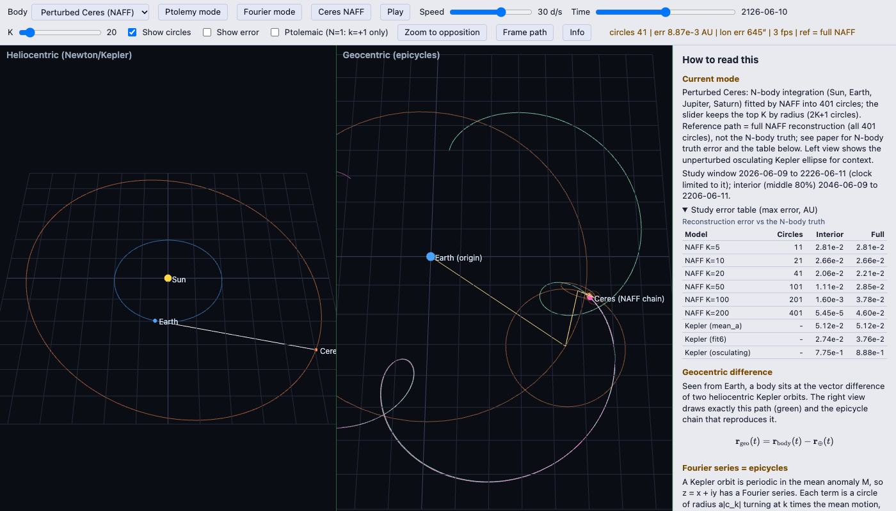

# epicycles

Companion code for the paper "Geocentric epicycle expansions of Keplerian orbits: explicit coefficients, error bounds, and frequency analysis": a paper, a Python reference implementation, and an interactive 3D viewer.

**Live demo:** https://ebowman.github.io/epicycles/ - paper: https://ebowman.github.io/epicycles/paper.pdf (source in `paper/`). `npm --prefix web run build:single` produces one self-contained `web/dist-single/index.html` that works offline from `file://`.

## Hypothesis and verdict

Hypothesis: Ptolemaic epicycles are Fourier-type series, so any bounded classical Newtonian trajectory seen from Earth can be written as a system of epicycles. Verdict: supported, with qualifications. A bound Kepler orbit is an exact Fourier series in the mean anomaly with Bessel-function coefficients, each term being a pair of counter-rotating circles. The geocentric position of a body (`r_body - r_earth`) is therefore an exact, uniformly convergent sum of two epicycle families with Bessel-coefficient radii. It is Bohr almost-periodic, not a single Fourier series. The Ptolemaic model is the circular two-term approximation (model A: a 2-circle, k=+1 model; for Mars it reproduces the retrograde loops with longitude errors up to 33 degrees). Perturbed (N-body) motion is quasi-periodic and is recovered on finite windows by numerical frequency analysis (NAFF); the representation fails for unbound orbits and long-term chaos. The core idea is classical (Hanson 1960, Gallavotti 2001, Scholz 2022 and others; see `research/lit-review.md`). The contribution here is the explicit, quantitative three-dimensional geocentric construction. See `paper/main.tex` for the abstract and results.

## Layout

- `research/` literature review and `refs.bib` (source of truth for bibliography)
- `theory/` derivation notes
- `epicycles/` Python package (Kepler solver, Bessel expansion, bounds, frames, NAFF, N-body, JSON export)
- `tests/` pytest suite
- `experiments/` scripts: perturbed Ceres run, figure generation, golden-data export
- `figures/` generated paper figures and `captions.md`
- `paper/` revtex4-2 LaTeX source and Makefile
- `web/` Vite + TypeScript + three.js single-page viewer
- `docs/` epicycle JSON schema (`epicycle-schema.md`) and `screenshots/`

## Prerequisites

- [uv](https://docs.astral.sh/uv/) and Python >= 3.11
- Node >= 22.12 (`web/.nvmrc` pins 24)
- TeX Live with `pdflatex`, `bibtex` and revtex4-2 (`latexmk` is not required)

## Commands

```bash
uv sync                                          # install Python deps
uv run pytest -q                                 # test suite
uv run python experiments/perturbed_ceres.py     # N-body Ceres + NAFF, ~3 min, regenerates experiments/out
uv run python experiments/make_figures.py        # figures/*.pdf, captions.md, web/public/data/*.json
uv run python experiments/export_golden.py       # golden test vectors for the TS port

make -C paper                                    # build paper/main.pdf
make -C paper clean

npm --prefix web ci                              # install web deps
npm --prefix web run dev                         # dev server
npm --prefix web run build                       # typecheck + production build
npm --prefix web run build:single                # single offline web/dist-single/index.html (opens from file://)
npm --prefix web test                            # vitest (incl. golden tests)
npm --prefix web run preview                     # serve the production build
```

## Viewer URL parameters

| Param | Meaning |
|---|---|
| `preset=ptolemy\|fourier\|ceres-naff` | start from a preset (sets body, N, flags) |
| `body=mars\|ceres\|eros\|phaethon\|naff` | observed body (`naff` = perturbed Ceres) |
| `N=` | number of harmonics (clamped per body) |
| `t=` | start time, Julian date TDB |
| `speed=` | simulation speed, clamped to 1..200 (default 30) |
| `paused=1` | start paused |
| `zoom=opp` | zoom to opposition |
| `circles=0` | hide epicycle circles |
| `info=0` | hide the explanatory panel |
| `ptolemaic=1` | circular two-term (Ptolemaic) approximation; takes effect only at N=1 (for N>1 the full chain is drawn) |
| `fourier=1` | start at N=1 and animate N from 1 to 20 over 8 s, then hold at 20 (any manual N/body change stops it) |
| `error=1` | show error versus the reference |

Example: `http://localhost:5173/?preset=ptolemy&paused=1`




## Known limitations

- No validation against JPL Horizons; planetary elements are approximate J2000 values.
- NAFF reconstructions suffer window-edge effects; the full-window error is edge-limited.
- In NAFF mode the reference curve is the full NAFF reconstruction, not N-body truth.
- 60 fps on a real GPU is unverified.
- Truncation orders needed grow rapidly at high eccentricity (hundreds of harmonics at e = 0.89). The paper's bound certifies an order growing like (1-e)^{-3/2}; the actual minimal order is smaller and saturates as e approaches 1.
- Circle counts in the viewer are series terms: order N gives 2N rotating circles per orbit plus a static k=0 offset.

## License

- Code (`epicycles/`, `experiments/`, `tests/`, `web/`): MIT, see `LICENSE`.
- Paper, figures, theory, research prose, and docs (`paper/`, `figures/`, `theory/`, `research/`, `docs/`): CC BY 4.0, see `LICENSE-CC-BY-4.0`.

## Citation

See `CITATION.cff`. A v1.0 release is archived on Zenodo (DOI assigned at release).
